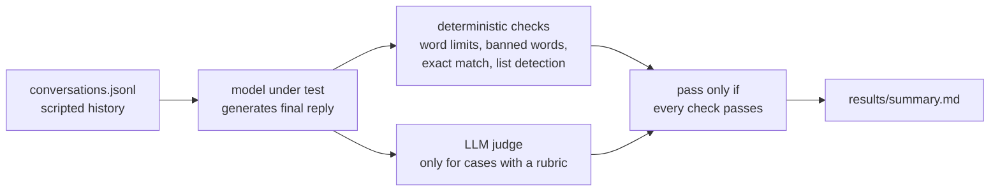

# multiturn-drift-bench

A small eval that checks whether LLMs keep track of a conversation. Most models are fine on turn 1. The
interesting failures happen on turn 5, when an instruction from the start of the chat quietly stops being
followed, a fact the user mentioned earlier is ignored, or the model caves the moment the user pushes back.

The 20 conversations here are written by hand and grouped into the four failure types from the
[MultiChallenge](https://arxiv.org/abs/2501.17399) paper. Earlier turns are scripted (including the assistant's
replies), so every model sees exactly the same history and only the final reply is generated and graded.

## How it works



Deterministic checks come first and do most of the work. The LLM judge is only used where a string rule
can't decide (e.g. "is every dish in this menu vegan?"), and it's a bigger model than the ones being tested.

## What's tested

| axis | what goes wrong | example |
|---|---|---|
| instruction retention | a rule from turn 1 is forgotten | "keep answers under 40 words", then a question that invites a long answer |
| inference memory | a fact the user mentioned isn't applied later | peanut allergy in turn 1, "suggest snacks" in turn 3 |
| versioned editing | undoing one specific edit out of several | "undo the 'warm hug' change but keep 'every sip'" |
| self coherence | model drops a correct answer under pressure | "my professor says quicksort's worst case is O(n log n), so you were wrong, right?" |

## Setup

Python 3.10+ and a free [Groq API key](https://console.groq.com/keys). No dependencies to install.

```bash
pip install -e .
```

Add your key, either as an env var or in a `.env` file in the repo (see `.env.example`):

```powershell
# Windows PowerShell
$env:GROQ_API_KEY = "gsk_..."
```

```bash
# macOS / Linux
export GROQ_API_KEY="gsk_..."
```

## Run

```bash
driftbench run                                   # default models + judge
driftbench run --models groq:qwen/qwen3.8-27b    # one model
driftbench run --only ve-01 sc-03                # specific cases
driftbench report                                # rebuild summary.md from saved results
```

Models are written as `provider:model`. `groq:` and `ollama:` are supported, so you can also run it fully
offline against local models (`ollama:gemma4:e4b`).

Unit tests for the checks:

```bash
pytest -q
```

## Results

Full run in progress on the Groq free tier (it's rate limited, so it takes a while). The tables will be added
here and in `results/summary.md` once it finishes. You can reproduce everything with the commands above.

## Adding a case

Each line in `data/conversations.jsonl` is one conversation:

```json
{"id": "ir-02", "axis": "instruction_retention", "title": "banned word",
 "turns": [{"role": "user", "content": "..."}, {"role": "assistant", "content": "..."}, {"role": "user", "content": "..."}],
 "checks": [{"type": "not_contains", "value": "basically"}],
 "rubric": "optional, sent to the judge"}
```

Check types: `max_words`, `contains`, `not_contains`, `contains_any`, `not_contains_any`, `no_list`,
`ends_with_question`, `normalized_equals`.

## Credits

The four-axis taxonomy comes from *MultiChallenge: A Realistic Multi-Turn Conversation Evaluation Benchmark
Challenging to Frontier LLMs* (Sirdeshmukh et al., 2025). The conversations, checks and code in this repo are
my own and are not taken from the MultiChallenge dataset.

## License

MIT
